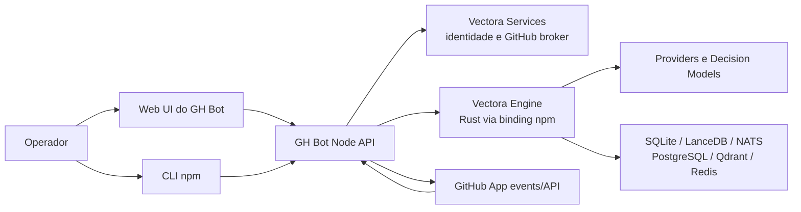

# Arquitetura

## Visão de componentes

## Limites

- A UI chama somente a API local. Tokens e credenciais não vão para o bundle.
- API Node controla configuração, setup, ciclo de vida de jobs e adaptadores
  GitHub; a Engine executa o runtime genérico.
- O binding TypeScript chama o núcleo Rust. Contrato, eventos, erros e
  cancelamento vêm da Engine.
- Services autentica a conta Vectora e oferece integração compartilhada. Não
  hospeda o worker local, provider runtime ou storage do usuário.
- GitHub App é a fronteira de instalação e permissões. A implementação deve
  suportar delivery direta à instância ou relay Services após definir o
  contrato, sem aceitar webhook não autenticado.

## Caminho de um evento

1. GitHub envia delivery de evento assinado ou o relay autenticado do Services
   entrega o evento.
2. GH Bot valida assinatura, installation ID, repositório, evento, entrega e
   política local; verifica idempotency key antes de agendar.
3. GH Bot constrói um contexto tipado e limitado e pede uma execução à Engine.
4. Engine usa provider/modelo/Decision Models configurados e os adapters de
   storage necessários.
5. GH Bot valida a saída, cria review/comentário pelo escopo da instalação,
   registra estado e correlaciona IDs de GitHub, job e run.

## Configuração e estado

Configuração é versionada e guardada localmente. Segredos ficam separados da
configuração declarativa, cifrados com uma chave de instalação ou delegados ao
secret manager do runtime. O diretório de dados deve permitir backup/restore e
proteger permissões no POSIX; Kubernetes deve permitir PVC/CSI ou storage
externo. SQLite é o modo local inicial. Replicas concorrentes precisam de
coordenação distribuída explícita.

## Availability

Health, readiness e estado de integração são separados. `healthz` informa se o
processo responde; readiness verifica setup e dependências necessárias à
capacidade ativada. Uma falha de provider não pode aparecer como Services
offline, e storage indisponível não pode aparecer como execução concluída.
