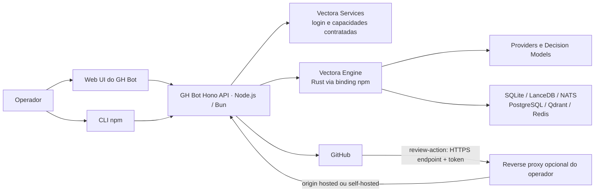

# Arquitetura

## Visão de componentes

## Limites

- O produto é um único app e pacote npm. `app/src/frontend/` contém a UI e
  `app/src/server/` contém a CLI e a API Hono; ambos são compilados/publicados
  juntos sem workspace ou pacote frontend separado.

- A UI chama somente a API local. Tokens e credenciais não vão para o bundle.
- API Hono controla configuração, setup, ciclo de vida de jobs e adaptadores
  GitHub; a Engine executa o runtime genérico.
- O binding TypeScript chama o núcleo Rust. Contrato, eventos, erros e
  cancelamento vêm da Engine.
- Services autentica a conta Vectora e oferece capacidades compartilhadas
  explicitamente contratadas. Não encaminha cada evento, chamada GitHub,
  chamada de modelo ou operação de storage.
- GitHub App/`review-action` são as fronteiras de instalação, autorização e
  chamadas. Self-hosted recebe a chamada direto na sua URL; hosted usa o
  endpoint operado pela Vectora. Não aceitar requests não autenticados.

## Caminho de um evento

1. `vectora-review-action` no workflow do repositório chama diretamente o
   endpoint público configurado, autenticando com token/segredo. Um reverse
   proxy configurado pelo operador pode terminar TLS e encaminhar o request;
   Services não processa esse payload.
2. GH Bot valida a autenticação, instalação, repositório, evento, entrega e
   política local; verifica idempotency key antes de agendar.
3. GH Bot constrói um contexto tipado e limitado e pede uma execução à Engine.
4. Engine usa provider/modelo/Decision Models configurados e os adapters de
   storage necessários.
5. GH Bot valida a saída, cria review/comentário pelo escopo da instalação,
   registra estado e correlaciona IDs de GitHub, job e run.

## API HTTP

- A API é dividida em grupos versionados (`/api/v1`) e rotas de sistema
  (`/healthz`, `/readyz`); contratos OpenAPI são expostos em
  `/api/openapi.json`.
- Cada rota valida entrada e saída por schema. Erros HTTP são normalizados e
  erros inesperados não expõem stack traces ao cliente.
- Middleware comum adiciona request ID, cabeçalhos seguros, limite de corpo,
  CORS por allowlist explícita e logs estruturados com duração e status.
- O adapter Node usa `@hono/node-server`; Bun usa `Bun.serve` e o adapter
  estático de Bun. Ambos entregam o mesmo app Hono e assets do painel.
- Desenvolvimento local usa Vite com proxy para a API. Para uso remoto, o
  operador publica o endpoint por HTTPS através do reverse proxy que administra.

## Painel web

- React e Vite compõem o painel sem acoplamento ao processo desktop do Vectora.
- TanStack Router controla rotas tipadas e navegação; TanStack Query mantém o
  estado remoto e políticas de cache/refetch.
- Zustand fica reservado ao estado transitório de interface. Estado de API não
  é duplicado no store global.
- Motion anima transições locais; `MotionConfig` respeita a preferência de
  movimento reduzido do sistema operacional.

## Configuração e estado

O modo hospedado é operado pela Vectora Ltda e controlado por assinatura. No
modo self-hosted, o usuário opera o processo, endpoint e storage em sua
infraestrutura. Os dois modos consomem a mesma Engine e têm a mesma UI/CLI; só
mudam hospedagem, responsabilidade operacional e entitlement. O fluxo de review
não passa pelo backend de aplicação do Services: `review-action` chama o
endpoint público, que pode ser exposto por um reverse proxy até o origin.

Configuração é versionada e guardada no runtime correspondente. Segredos ficam separados da
configuração declarativa, cifrados com uma chave de instalação ou delegados ao
secret manager do runtime. O diretório de dados deve permitir backup/restore e
proteger permissões no POSIX; Kubernetes deve permitir PVC/CSI ou storage
externo. SQLite é o modo local inicial. Replicas concorrentes precisam de
coordenação distribuída explícita.

## Availability

Health, readiness e estado de integração são separados. `healthz` informa se o
processo responde; readiness verifica setup e dependências necessárias à
capacidade ativada. Uma falha de provider não pode aparecer como Services
offline, e storage indisponível não pode aparecer como execução concluída.
